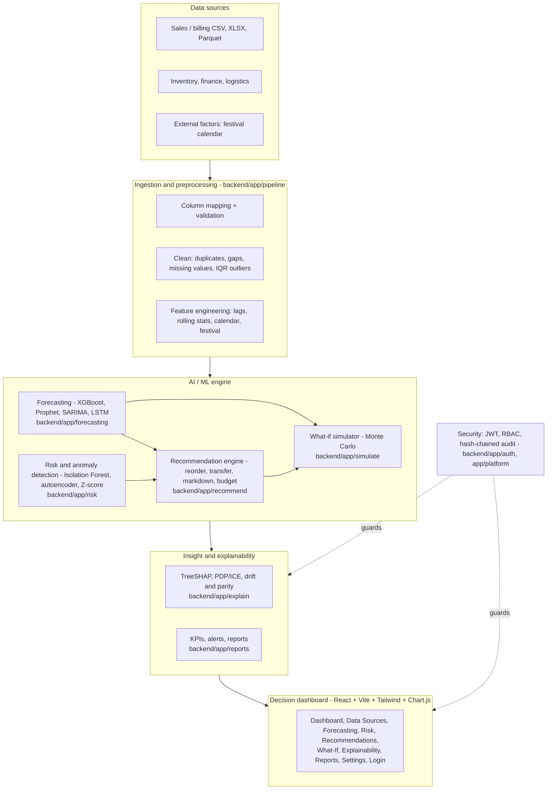
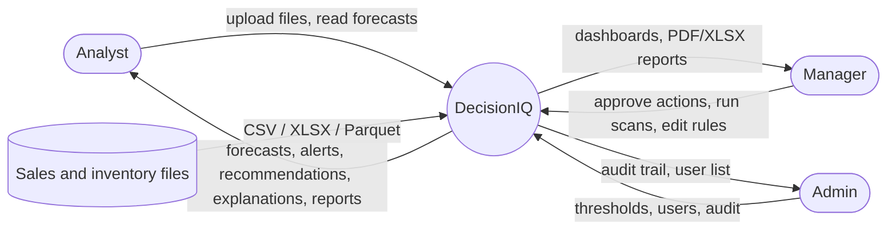
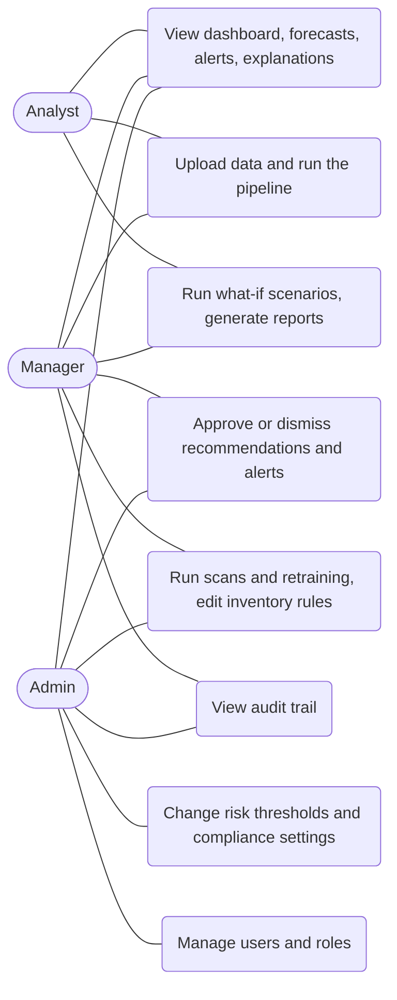
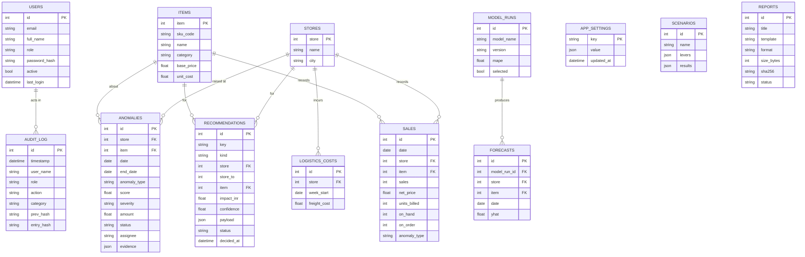
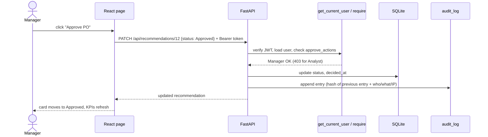
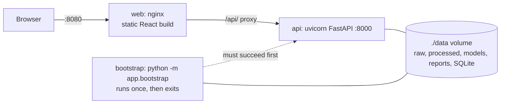

# DecisionIQ - architecture and diagrams

All diagrams are [Mermaid](https://mermaid.js.org/): they render on GitHub, in VS Code (Markdown preview) and at mermaid.live, and can be exported as PNG/SVG for the report.

## 1. Layered architecture (matches the proposal's five layers)



## 2. Context diagram (DFD level 0)



## 3. Data flow (DFD level 1)

```mermaid
flowchart LR
    RAW[(data/raw/train.csv)] --> P1[1 Generate synthetic<br/>prices, inventory, anomalies<br/>ml/prepare_data.py]
    P1 --> D1[(data/processed/*.csv)]
    UP[Uploaded file] --> P2
    D1 --> P2[2 Ingest, map, clean,<br/>engineer features]
    P2 --> D2[(features.parquet<br/>pipeline_state.json)]
    D2 --> P3[3 Train and benchmark<br/>4 models, refit, forecast 90 days]
    P3 --> D3[(models/: xgb.json, forecasts, backtest,<br/>benchmark.json)]
    D1 --> P4[4 Detect anomalies]
    P4 --> D4[(risk/: metrics, billed.parquet)]
    P4 --> DB[(SQLite: anomalies)]
    D3 --> P5[5 Recommend actions]
    D1 --> P5
    P5 --> DB2[(SQLite: recommendations)]
    D3 --> P6[6 Explain / simulate / report]
    DB --> P6
    DB2 --> P6
    P6 --> OUT[API responses, reports/*.pdf|xlsx|json]
    OUT --> UI[React dashboard]
    UI -->|approve, edit, settings| DB3[(SQLite: decisions, settings, audit_log, users)]
```

## 4. Use cases by role



## 5. Data model

The application keeps *analytical* data in files (CSV/Parquet/JSON under `data/`) and *operational* data in the relational database (SQLite by default, SQLAlchemy models in `backend/app/db/models.py`).
`sales`, `model_runs` and `forecasts` tables exist in the schema (and `python -m app.db.load_data` can fill `sales`) but the running application reads those from files.



## 6. Sequence: approving a recommendation



## 7. Sequence: training and forecast serving

```mermaid
sequenceDiagram
    participant API as POST /api/forecast/retrain
    participant T as train.run_training
    participant X as XGBoost (in process)
    participant Q as Prophet / SARIMA (per series)
    participant L as LSTM worker (subprocess)
    participant FS as data/processed/models
    API->>T: background task (lock: one run at a time)
    T->>X: backtest on all 500 series, last 90 days held out
    T->>Q: backtest on a 20-series sample
    T->>L: backtest (TensorFlow runs in its own process)
    T->>T: select best by MAPE; serving model = best global model
    T->>X: refit on all data, recursive 90-day forecast
    T->>FS: forecasts.parquet, backtest.parquet, sigma.parquet, xgb.json, benchmark.json
    Note over API,FS: GET /api/forecast/* reads these files (cached by mtime)
```

## 8. Deployment (docker compose)


