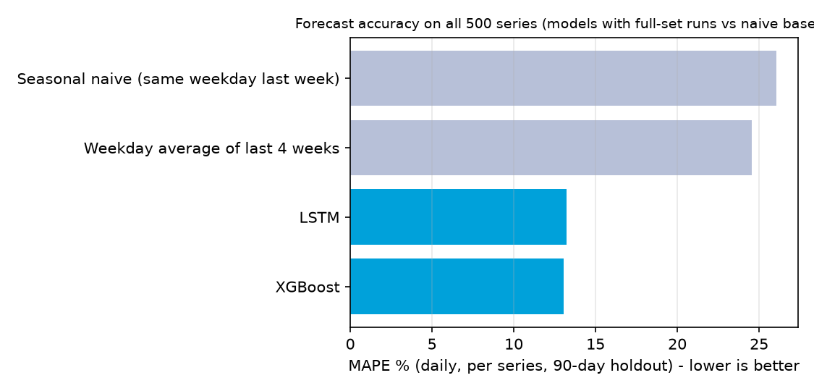
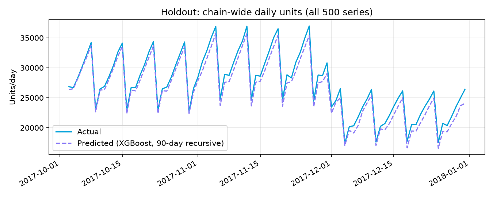
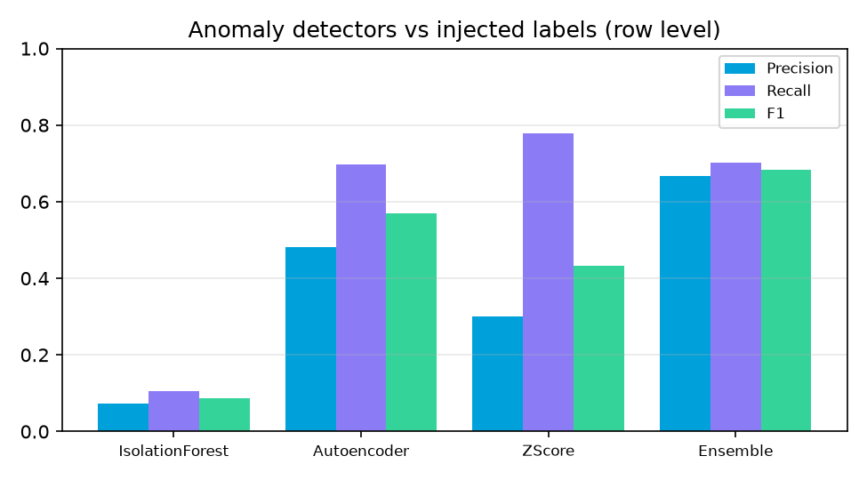

# Chapter 4 - Findings and Results (draft)

*Draft prepared from the project's measured outputs. Every number below comes from `docs/results/EVALUATION.md` (regenerate with `python -m app.evaluation.report --with-tests`);
figures are in `docs/results/figures/`. Edit the wording to your department's style; do not change the numbers without re-running the evaluation.*

## 4.1 Data presentation

### 4.1.1 Datasets used
| Part | Source | Size | Used for |
|---|---|---|---|
| Sales history | Kaggle *Store Item Demand Forecasting Challenge* (real) | 913,000 daily rows, 10 stores x 50 items, 1 Jan 2013 - 31 Dec 2017 | Training and testing all forecasting models |
| Store / item master | Synthetic (Karnataka cities, 5 categories) | 10 stores, 50 items | Context for the retail scenario |
| Prices, promotions, festival calendar, costs | Synthetic | per store-item-day | Pricing, margin, recommendations, simulator |
| Inventory (stock, on-order) | Synthetic (reorder-point policy on the real demand) plus a last-day scenario with 8% excess-stock and 10% delayed-delivery series | per store-item-day | Replenishment recommendations |
| Anomalies | Synthetic injections on the *billed* columns only | 944 rows (200 duplicate billing, 150 margin erosion, 594 demand-drop days) + 40 logistics spikes | Evaluating anomaly detection |

**Important for the examiner:** the real sales values were never modified. Price and promotion columns were generated independently of sales, so they carry no learnable demand signal; the forecasting models therefore rely on lags, rolling statistics, the calendar and a festival flag.
All synthetic assumptions are listed in `docs/report/OBJECTIVES_TRACEABILITY.md`.

### 4.1.2 Data preparation
The ingestion pipeline mapped the source columns automatically, found no duplicate, missing or negative values, capped 3 outliers (IQR x 3 rule) and scored the dataset **100/100**. It produced 12 features (lag_7, lag_30, rolling mean/std over 14 days, calendar and cyclical month features, festival and promotion flags). The whole cleaning and feature step takes about 2.5 seconds for 913,000 rows.

### 4.1.3 Forecast accuracy
The last 90 days (3 Oct - 31 Dec 2017) were held out; every model forecasts the entire holdout recursively from the training cut-off.

**Four models and two naive baselines on a 20-series sample (2 items per store)** (Prophet and SARIMA fit one model per series, so the comparison uses a sample):

| Model | MAE | RMSE | MAPE % | WAPE % | R2 | Train time (s) |
|---|---|---|---|---|---|---|
| XGBoost (selected) | 6.72 | 8.90 | 12.28 | 10.52 | 0.93 | 6.8 |
| LSTM | 6.79 | 9.01 | 12.42 | 10.64 | 0.93 | 77.8 |
| Prophet | 6.80 | 8.95 | 13.37 | 10.65 | 0.93 | 7.4 |
| SARIMA | 12.24 | 16.74 | 23.81 | 19.16 | 0.76 | 7.7 |
| Weekday average of last 4 weeks (naive) | 12.47 | 16.93 | 24.28 | 19.52 | 0.75 | - |
| Same weekday last week (naive) | 13.80 | 18.50 | 26.42 | 21.61 | 0.71 | - |

**All 500 series (models that scale to every series):**

| Model | MAE | RMSE | MAPE % | WAPE % | MAPE % on daily chain total | R2 |
|---|---|---|---|---|---|---|
| XGBoost | 6.21 | 8.16 | **13.03** | 11.37 | **3.55** | 0.92 |
| LSTM | 6.29 | 8.26 | 13.23 | 11.52 | 4.65 | 0.92 |
| Weekday average (naive) | 10.77 | 14.41 | 24.54 | 19.72 | 16.06 | 0.74 |
| Same weekday last week (naive) | 11.65 | 15.41 | 26.06 | 21.32 | 15.37 | 0.71 |

**Error by horizon (XGBoost):** WAPE 10.8% (days 1-30), 10.8% (days 31-60), 13.0% (days 61-90). Bias is negative and grows with the horizon (-1.8%, -3.9%, -5.0%): the forecasts run low.
**Error by store and category:** WAPE between 10.4% and 13.2% across the ten stores and between 10.7% and 12.1% across the five categories - no group is served markedly worse.

### 4.1.4 Explainability output
Each forecast can be decomposed with exact TreeSHAP values (base value + feature contributions = the forecast; verified to within 1e-6 in tests). Globally the 14-day rolling mean (about 51% of mean |SHAP|), the same-weekday-last-week lag (15%) and the day of week (13%) dominate; calendar seasonality and festival flags contribute about 11%, store/product identity about 2%.
Drift check (PSI, last 90 days vs earlier): all features below 0.13 (moderate at most, partly seasonal). Error parity across stores: 91%.

### 4.1.5 Anomaly and risk detection
Row-level results against the injected anomalies (the detectors never see the labels):

| Detector | Precision | Recall | F1 |
|---|---|---|---|
| Isolation Forest | 0.07 | 0.10 | 0.09 |
| Autoencoder (MLP 8-3-8) | 0.48 | 0.70 | 0.57 |
| Z-score rules | 0.30 | 0.78 | 0.43 |
| **Ensemble (at least 2 of 3 agree)** | **0.67** | **0.70** | **0.68** |

Ensemble recall by type: duplicate billing 0.59, demand drop 0.70, margin erosion 0.87; 79% of injected events were detected at least once; logistics cost spikes (separate weekly Z-score check): precision 0.60, recall 0.75, F1 0.67. A scan of the whole history takes about 14 seconds and creates 737 alerts (111 High severity).

**Sample alerts produced:**
- *ALT-0582, duplicate billing, Hubballi Hub, Consumer Tech Item 16, 31 Aug 2013:* "Billed 62 units vs ~28 expected (2.2x, z=3.9); pattern consistent with an invoice counted twice." Estimated exposure Rs 7.8 lakh.
- *ALT-0044, margin erosion, Bengaluru Indiranagar, Consumer Tech Item 36, 22 Sep 2016:* "Sold at Rs 15,157 against list Rs 25,627 (41% off) and cost Rs 21,653: margin -43%."
- *ALT-0106, demand drop, Bengaluru Whitefield, Ethnic Apparel Item 24, 5 Jun 2015:* "Billed units stayed far below the ~107/day baseline for 3 day(s) (sustained-drop z=12.3)."

### 4.1.6 Recommendations and what-if simulation
From the 90-day forecast and the current stock position the engine produced 49 actions: 24 reorders, 15 inter-store transfers, 7 markdowns (perishable categories only) and 3 marketing-budget shifts. Each carries an impact estimate, a confidence value and a step-by-step calculation, for example:
*"Transfer 659 units of Consumer Tech Item 36 from Bengaluru Jayanagar to Hubballi Hub - donor holds 75 days of cover (5,160 units); target cover 21 days = 1,445 units; transferable surplus 3,715 units."*
The Monte Carlo what-if simulator (250-1,000 runs; about 0.6 s for all 500 series) re-simulates 30 days of demand and inventory when price, voucher, marketing, safety stock, lead time or shocks are changed. For example, cutting an electronics price by 8% with a 12% voucher raises units by about 49% but lowers net profit because electronics margins are thin - the same conclusion the recommendation engine reaches.

### 4.1.7 System screens and performance
Dashboard, Data Sources, Forecasting (and Engine States), Risk & Anomalies, Recommendations, What-If, Explainability, Reports, Settings and Login were implemented from the design mock-ups (see `docs/design/` and `docs/report/OBJECTIVES_TRACEABILITY.md`).
Typical request times on the development machine: dashboard 30 ms, forecast series 55 ms, SHAP explanation 55 ms, simulation 0.6 s; 90-day forecast for all series 0.2-0.4 s; full model training and benchmarking 127 s (LSTM 78 s of it).
Automated tests: 79 backend tests (91% line coverage) and 39 frontend tests, all passing.

## 4.2 Analysis against the project objectives

| Success criterion in the proposal | Result | Verdict |
|---|---|---|
| Forecast error (MAPE) within 10-15% on test data | 13.0% per series-day on all 500 series; 3.6% on chain totals (naive baselines: 24.5%) | **Met** |
| Compare ARIMA/SARIMA, Prophet, XGBoost, LSTM | All four implemented and benchmarked; XGBoost and LSTM best, Prophet close, SARIMA weakest | **Met** |
| Detect anomalies with precision / recall / F1 | Ensemble 0.67 / 0.70 / 0.68 on synthetic labels | **Met on synthetic data; real-world accuracy unknown** |
| "Near real-time" risk alerts | Alerts appear after a batch scan (14 s for the whole history); there is no streaming | **Partly met** |
| Explainable outputs (SHAP/LIME) | Exact TreeSHAP, plain-language summaries, PDP/ICE; no LIME | **Met (SHAP), LIME not done** |
| Recommendations for reorder, pricing, budget | All implemented with audit trails; quality has no ground truth to be scored against | **Implemented, not validated** |
| Role-based access, periodic retraining | Role-based access and JWT done; retraining is manual (no scheduler) | **Partly met** |

## 4.3 Direct answers to the research questions

**RQ1 - How can data from multiple sources be integrated and used to forecast sales and demand at product, category and regional level?**
A mapping-based ingestion pipeline (CSV/Excel/Parquet) cleans the data and builds lag, rolling and calendar features; a global XGBoost model forecasts all 500 store-item series recursively for 90 days, with category and store views obtained by aggregation. On the held-out 90 days it reached 13.0% MAPE per series-day (3.6% on daily chain totals), against 24.5% for the best naive baseline. Database and ERP connectors were not built; only file ingestion is implemented.

**RQ2 - How can anomaly detection identify risks such as fraudulent transactions, cost spikes and abnormal demand variation in near real time?**
Three unsupervised detectors (Isolation Forest, autoencoder, Z-score rules) vote; a row is flagged when two agree. On injected anomalies the ensemble reaches precision 0.67 and recall 0.70, clearly better than any single detector, and logistics cost spikes are found with F1 0.67. Detection is batch (a full scan takes 14 s), so alerts are "near real time" only if the scan is run frequently. Precision is understated because genuinely unusual days in the real data are not labelled.

**RQ3 - How can forecasts and risk signals be converted into explainable recommendations for inventory, pricing and resource allocation?**
The recommendation engine combines the forecast, its uncertainty, current stock and costs into reorder quantities (order-up-to level with safety stock), inter-store transfers, markdowns (price elasticity plus shelf-life write-off) and budget shifts. Every action shows its calculation step by step, a confidence value, and can be edited before approval; the Explainability page shows why the underlying forecast is high or low. The pricing and budget logic depends on stated assumptions (elasticities, write-off rates, marketing budget share, a placeholder ROAS) because the data contains no price response or ad-spend history; risk signals are shown next to the recommendations but are not yet an input to them.

## 4.4 Threats to validity (state these in the report)
1. Real demand, **synthetic** everything else: conclusions about pricing, inventory, fraud and margins describe the method, not a real retailer.
2. Anomaly labels are injected by the same author who built the detectors; real fraud would be messier.
3. One dataset, one 90-day holdout (Q4 2017); results may differ in other periods.
4. No user study has been run (template: `docs/results/usability_questionnaire.md`).
5. Recommendation quality was not measured against realised outcomes.
