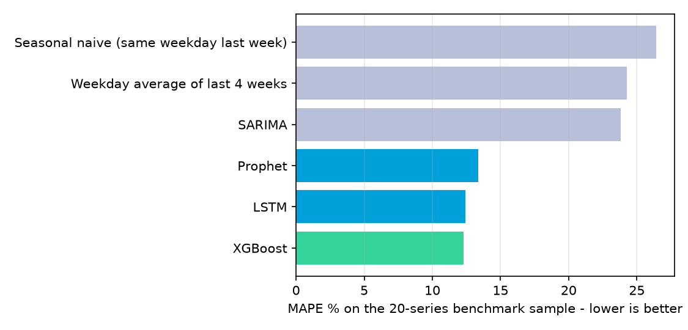
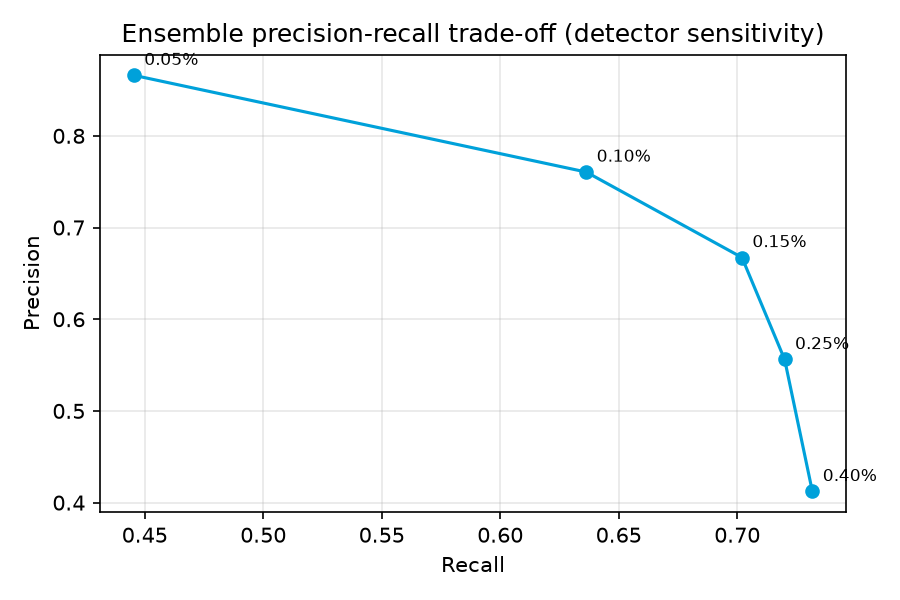

# DecisionIQ - Evaluation results

Generated 2026-10-27 00:03 by `python -m app.evaluation.report`. Model version `xgboost-202610262117`.

**Data.** Real: Kaggle Store Item Demand Forecasting sales (913,000 rows, 10 stores x 50 items, 2013-2017). Synthetic: prices, promotions, festival calendar, inventory,
logistics costs and all anomaly labels. Forecasts use only the real sales plus calendar features; price/promotion columns carry no learnable signal because they were generated independently of sales.

**Headline numbers**

| Measure | Value |
|---|---|
| Serving forecast model | XGBoost |
| MAPE per series-day, all 500 series (target 10-15%) | 13.0% |
| MAPE on chain-wide daily totals | 3.6% |
| WAPE / R2 | 11.4% / 0.92 |
| Best naive baseline MAPE (same weekday last week / 4-week weekday mean) | 24.5% |
| Anomaly ensemble precision / recall / F1 (synthetic labels) | 0.67 / 0.70 / 0.68 |

**Not evaluated.** Recommendation quality has no ground truth (there is no record of what managers would have decided or of realised outcomes); the what-if simulator and
price/marketing responses rely on stated assumptions; no user study has been run (a questionnaire template is in `usability_questionnaire.md`).

## 1. Forecasting accuracy

Holdout: the last 90 days (2017-10-03 to 2017-12-31). Every model forecasts the whole holdout **recursively from the training cut-off**
(multi-step, no peeking at holdout actuals). MAPE ignores zero-demand days; WAPE = sum|error| / sum(actual); the *chain total* MAPE is on daily totals across series.

### 1.1 All four models and two naive baselines, 20-series sample (2 items per store)
Prophet and SARIMA fit one model per series, so all models are compared on the same 20-series sample.

| Model | Scope | MAE | RMSE | MAPE % | WAPE % | R2 | Train s | Role |
|---|---|---|---|---|---|---|---|---|
| XGBoost | 20-series sample | 6.72 | 8.90 | 12.28 | 10.52 | 0.93 | 6.80 | Selected |
| Prophet | 20-series sample | 6.80 | 8.95 | 13.37 | 10.65 | 0.93 | 7.40 | Evaluated |
| SARIMA | 20-series sample | 12.24 | 16.74 | 23.81 | 19.16 | 0.76 | 7.70 | Baseline |
| LSTM | 20-series sample | 6.79 | 9.01 | 12.42 | 10.64 | 0.93 | 77.80 | Evaluated |
| Seasonal naive (same weekday last week) | 20-series sample | 13.80 | 18.50 | 26.42 | 21.61 | 0.71 | 0.00 | Naive baseline |
| Weekday average of last 4 weeks | 20-series sample | 12.47 | 16.93 | 24.28 | 19.52 | 0.75 | 0.00 | Naive baseline |

### 1.2 Models trained on every series (all 500 series)
| Model | MAE | RMSE | MAPE % | WAPE % | MAPE % (daily chain total) | R2 |
|---|---|---|---|---|---|---|
| XGBoost | 6.21 | 8.16 | 13.03 | 11.37 | 3.55 | 0.92 |
| LSTM | 6.29 | 8.26 | 13.23 | 11.52 | 4.65 | 0.92 |
| Seasonal naive (same weekday last week) | 11.65 | 15.41 | 26.06 | 21.32 | 15.37 | 0.71 |
| Weekday average of last 4 weeks | 10.77 | 14.41 | 24.54 | 19.72 | 16.06 | 0.74 |

The serving model (XGBoost) reaches **13.0% MAPE** per series-day and **3.6%** on chain-wide daily totals, i.e. 47% lower MAPE than the best naive baseline (24.5%).
The project target was a MAPE within 10-15% on test data: it is met for per-series daily MAPE (13.0%) and at higher aggregation.

### 1.3 Error by forecast horizon (XGBoost, all series)
| Horizon | WAPE % | Bias % | Actual units |
|---|---|---|---|
| Days 1-30 | 10.80 | -1.81 | 862878 |
| Days 31-60 | 10.76 | -3.90 | 923821 |
| Days 61-90 | 12.95 | -4.95 | 671710 |

**Bias.** Forecasts run low: bias moves from -1.8% in the first 30 days to -4.9% in the last 30. Recursive multi-step forecasting feeds predictions back
as lags, which shrinks them toward the series mean, and the autumn peak in the Kaggle data is under-predicted. Error (WAPE) is stable at about 11% for 60 days and rises to 13% in the final month.

### 1.4 Error by category and store
| Category | WAPE % | Bias % | Actual units |
|---|---|---|---|
| Beverages | 10.88 | -3.96 | 554136 |
| Consumer Tech | 11.65 | -3.45 | 452208 |
| Ethnic Apparel | 12.13 | -2.07 | 410443 |
| Home Appliances | 11.92 | -2.60 | 426717 |
| Packaged Food | 10.73 | -4.53 | 614905 |

| Store | WAPE % | Bias % | Actual units |
|---|---|---|---|
| Bengaluru Indiranagar | 11.92 | -3.62 | 223033 |
| Bengaluru Whitefield | 10.76 | -4.65 | 315838 |
| Bengaluru Jayanagar | 10.83 | -3.84 | 279974 |
| Bengaluru Koramangala | 10.91 | -2.19 | 257895 |
| Mysuru Vijayanagar | 12.98 | -2.93 | 186658 |
| Mysuru Central | 12.68 | -2.34 | 186589 |
| Mangaluru Hub | 13.21 | -3.22 | 171120 |
| Mangaluru Kadri | 10.88 | -4.99 | 302732 |
| Hubballi Hub | 10.94 | -2.42 | 259241 |
| Belagavi Camp | 10.44 | -3.29 | 275329 |

Error is similar across categories and stores (WAPE 10.4-13.2% by store), so no store or category is served markedly worse.

## 2. Anomaly and risk detection

Ground truth is **synthetic**: 944 billed rows were corrupted on purpose (duplicate billing, margin erosion, multi-day demand drops) and 40 weekly logistics costs were spiked.
The detectors never see these labels. Row-level metrics, current settings (z = 3.0, sensitivity 0.15%):

| Detector | Precision | Recall | F1 | TP | FP | FN |
|---|---|---|---|---|---|---|
| IsolationForest | 0.07 | 0.10 | 0.09 | 99 | 1265 | 844 |
| Autoencoder | 0.48 | 0.70 | 0.57 | 657 | 707 | 286 |
| ZScore | 0.30 | 0.78 | 0.43 | 733 | 1711 | 210 |
| Ensemble | 0.67 | 0.70 | 0.68 | 662 | 330 | 281 |

Ensemble = a row is flagged when at least 2 of 3 detectors agree. Recall of the ensemble by injected anomaly type:

| Anomaly type | Ensemble recall |
|---|---|
| duplicate billing | 0.59 |
| demand drop | 0.70 |
| margin erosion | 0.87 |

| Measure | Value |
|---|---|
| Event recall (demand-drop/duplicate/margin events detected) | 0.79 |
| Alert precision (alerts overlapping an injected anomaly) | 0.57 |
| Logistics cost spikes: precision / recall / F1 | 0.60 / 0.75 / 0.67 |
| Rows scanned / flagged / alerts | 909,000 / 992 / 737 |

### 2.1 Sensitivity sweep
Each row re-runs all detectors with one parameter changed (the other at its default).

| Parameter | Value | Precision | Recall | F1 | Rows flagged | Seconds |
|---|---|---|---|---|---|---|
| sensitivity (share of rows flagged by ML detectors) | 0.05% | 0.87 | 0.45 | 0.59 | 485 | 22.40 |
| sensitivity (share of rows flagged by ML detectors) | 0.10% | 0.76 | 0.64 | 0.69 | 789 | 20.40 |
| sensitivity (share of rows flagged by ML detectors) | 0.15% | 0.67 | 0.70 | 0.68 | 992 | 21.10 |
| sensitivity (share of rows flagged by ML detectors) | 0.25% | 0.56 | 0.72 | 0.63 | 1221 | 19.20 |
| sensitivity (share of rows flagged by ML detectors) | 0.40% | 0.41 | 0.73 | 0.53 | 1674 | 23.30 |
| z-score threshold | 2.5 | 0.57 | 0.70 | 0.63 | 1155 | 24.40 |
| z-score threshold | 3.0 | 0.67 | 0.70 | 0.68 | 992 | 22.80 |
| z-score threshold | 3.5 | 0.72 | 0.70 | 0.71 | 916 | 21.50 |
| z-score threshold | 4.0 | 0.73 | 0.69 | 0.71 | 890 | 21.50 |

**Tuning caution.** The sweep is scored against the same synthetic labels it is meant to evaluate, so picking the best row (see `best` in results.json) would be tuning on the test set.
The shipped defaults (z = 3, sensitivity 0.15%) were fixed before the sweep; moving the threshold trades precision for recall rather than finding a free improvement.

**Interpretation and caveats.** Isolation Forest alone is weak on these signals (F1 0.09); the autoencoder and Z-score rules are individually better and the voting ensemble is best (F1 0.68).
Precision is **understated** because the real Kaggle data contains genuinely unusual days that are not labelled; recall for duplicate billing is limited because a doubled sale at a low-volume store is statistically close to normal noise.
These numbers measure how well the detectors recover injected faults, not real-world fraud detection accuracy.

## 3. Performance

Measured on the development machine (Windows, CPU only). Request timings exclude authentication.

| Operation | Runs | Median s | p95 s |
|---|---|---|---|
| Data cleaning, 913,000 rows (dedupe, gaps, IQR capping) | 1 | 2.319 | 2.319 |
| Feature engineering, 913,000 rows (12 features) | 1 | 0.966 | 0.966 |
| 90-day recursive forecast, 500 series (XGBoost) | 3 | 0.447 | 0.545 |
| GET /api/dashboard/summary | 10 | 0.039 | 0.043 |
| GET /api/forecast/series (all stores, 30 days) | 10 | 0.060 | 0.129 |
| GET /api/risk/alerts (page of 8) | 10 | 0.014 | 0.019 |
| GET /api/recommendations | 10 | 0.015 | 0.020 |
| GET /api/explain/local (one series-day) | 10 | 0.117 | 0.157 |
| POST /api/simulate/run (all series, 250 runs) | 5 | 0.548 | 0.609 |

Batch jobs (from their last run):

| Job | Duration s |
|---|---|
| Risk scan over 913,000 billed rows (detect + alert ledger) | 24.4 |
| Full model training and benchmark (4 models + refit + forecast) | 126.7 |
|   training time, XGBoost | 6.8 |
|   training time, Prophet | 7.4 |
|   training time, SARIMA | 7.7 |
|   training time, LSTM | 77.8 |

Alert latency: anomaly detection is a batch scan (about 24.4 s for the whole history), so alerts appear after each scan, not in real time.

## 4. Automated tests

Backend (pytest): **79 passed in 75.69s (0:01:15)**; line coverage of `app/`: **91%** (2631 of 2880 statements).
This run includes the slow end-to-end training test (excluded from a plain `pytest`; run it alone with `pytest -m slow`).
Coverage omits the evaluation script itself and the LSTM worker, which runs in a separate process.

| Test file | Tests |
|---|---|
| tests/test_auth.py | 15 |
| tests/test_platform.py | 10 |
| tests/test_pipeline.py | 8 |
| tests/test_simulate.py | 8 |
| tests/test_forecasting.py | 7 |
| tests/test_recommend.py | 7 |
| tests/test_explain.py | 7 |
| tests/test_bootstrap.py | 6 |
| tests/test_dataset.py | 4 |
| tests/test_risk.py | 4 |
| tests/test_health.py | 2 |

Coverage by package:

| Package | Statements | Covered | Coverage % |
|---|---|---|---|
| app/api | 895 | 829 | 92.6 |
| app/auth | 107 | 104 | 97.2 |
| app/core | 13 | 13 | 100.0 |
| app/db | 195 | 169 | 86.7 |
| app/explain | 180 | 175 | 97.2 |
| app/forecasting | 268 | 209 | 78.0 |
| app/pipeline | 198 | 173 | 87.4 |
| app/platform | 96 | 94 | 97.9 |
| app/recommend | 222 | 220 | 99.1 |
| app/reports | 151 | 150 | 99.3 |
| app/risk | 248 | 225 | 90.7 |
| app/simulate | 190 | 188 | 98.9 |
| app/bootstrap.py | 91 | 58 | 63.7 |
| app/main.py | 26 | 24 | 92.3 |

Frontend smoke tests (Vitest + Testing Library) are described in the README (`npm test`).
